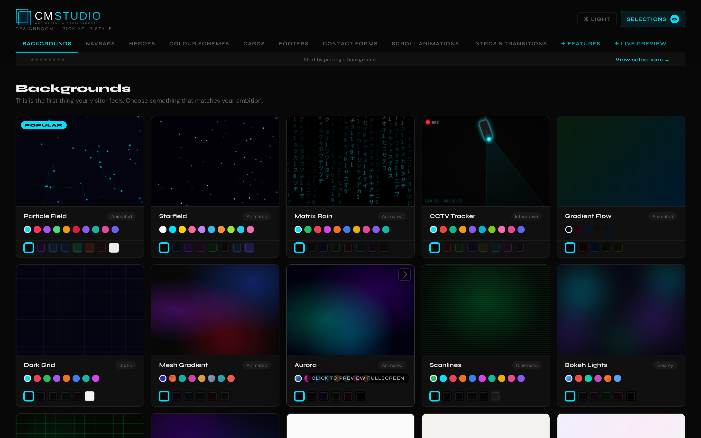

# CM Studio DesignRoom

A showroom where web-design clients pick live components and send a brief; I get ready-to-use code and a pre-filled starter site.

**[Live demo](https://cm-studio-designroom.vercel.app/?demo=1)** · **[Portfolio](https://cianmccaul.vercel.app)**



## What it does

A showroom for my web-design work. Instead of a long call about "what kind of website do you want?", a client clicks through real, working examples (backgrounds, navbars, heroes, colour schemes, cards, footers, forms, scroll animations and intros), picks the ones they like, and sends me a brief. I get the brief with ready-to-use code for every piece they chose.

**For clients**
- 8 categories of live components, plus extras like a booking widget, shop and live chat, all previewable full screen
- 15 colour schemes that re-theme the whole showroom in one click, and a light mode
- A live preview that assembles their picks into one page
- A 5-step brief: business details, pages and features, content, branding and inspiration, with mood-board image uploads
- Progress is saved in the browser, and a confirmation email goes out when they submit
- A **Skip intro** button (or Escape) on the opening animation

**For me (admin page)**
- Every brief with search, status (new, in progress, quoted, complete), priority and private notes
- The code for each chosen component, and a complete starter site (index.html, style.css and script.js) pre-filled with the client's business name, tagline and contact details, ready to download

### Demo mode

The live link above opens with `?demo=1`, so anyone can try the whole thing without sending me a real brief:

- Sending a brief shows the normal "Brief Submitted!" screen, but nothing is uploaded, saved to Supabase or emailed. In demo mode the Supabase and EmailJS clients are never even created.
- A small "Demo" badge in the corner says so, and the success screen says nothing was saved or sent.

Without `?demo=1` (the address I give clients) it works exactly as before.

## How it works

Plain HTML, CSS and JavaScript with no build step, so it deploys anywhere as static files.

| Part | Uses |
|---|---|
| Showroom and brief | `index.html`, `js/app.js`, `js/canvas.js` (animated backgrounds), `js/intro.js`, `js/cursor.js` |
| Sending a brief | `js/submit.js`: uploads mood boards and saves the brief to Supabase, then emails both sides with EmailJS |
| Demo mode | `js/demo.js`: reads `?demo=1`, adds the badge; `js/submit.js` skips every upload, save and email when it's on |
| Admin | `admin.html`, `js/admin-generators.js` (the code and starter-site generators) |
| Data | Supabase Postgres (`submissions` table) and Storage (`moodboards` bucket), set up by `supabase/schema.sql` |

### Security

The page only holds Supabase's publishable key, which is meant to be public. What protects the data is the database itself (`supabase/schema.sql`, on its own Supabase project in Ireland):

- **The public can only send a brief.** Row-level security allows anonymous inserts and nothing else, so briefs can't be read, changed or deleted from the site.
- **Only the admin can read briefs.** The admin page signs in with Supabase Auth (email and password), and the policies check that the signed-in user is the admin. Public sign-ups are off.
- **Mood boards:** images only, up to 5 MB, saved under random names. The bucket can't be listed; each image opens only from its own link.
- Everything a client typed is escaped before the admin page shows it.

## Run it locally

```
python3 -m http.server 8000
```

Then open http://localhost:8000/?demo=1 (leave off `?demo=1` and a brief really is saved and emailed). The admin page is at `/admin.html`.

## Tests

There are no automated tests yet. Demo mode was checked in a headless browser with stand-ins for the Supabase and EmailJS libraries: with `?demo=1` a full brief reaches the success screen with no calls to either, and without it the brief is saved and both emails are sent as before.

## Built with

HTML, CSS and vanilla JavaScript (no build step), Supabase (Postgres, Storage, Auth), EmailJS, Vercel.

## Colour schemes

Charcoal + Cyan (default), Navy + Gold, Black + White, Dark + Red, Slate + Emerald, Dark Forest, Deep Purple + Violet, Copper + Orange, Midnight + Pink, Ocean Dark + Teal, Rose + Blush, Steel + Ice, Amber + Dark, Blood + Iron and Sage + Linen.

---

© CM Studio, Cian McCaul. All rights reserved.
